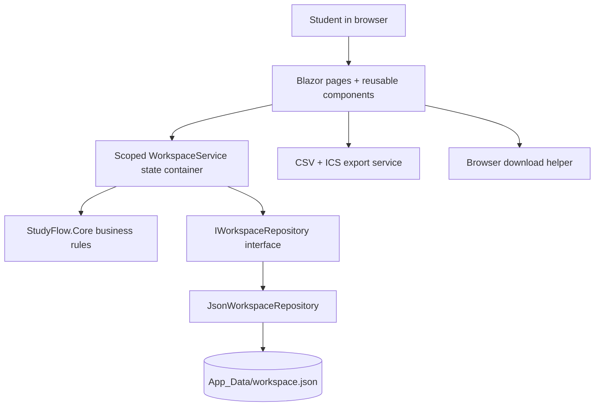
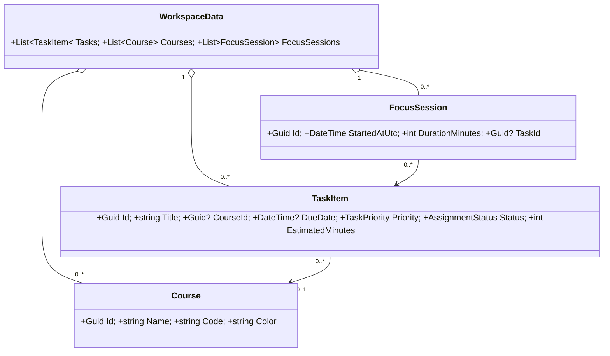

# Architecture and technical design

## Context

The intended user is one student who wants to manage school tasks without maintaining a database or signing in. The application is hosted locally as an ASP.NET Core web application and rendered with Blazor Interactive Server.

## Layer diagram

The design resembles a layered component architecture, rather than a full MVC application. Blazor components are the view layer; `WorkspaceService` coordinates actions; core services own deterministic business rules; the repository isolates persistence. This makes tests possible without opening a browser.

## Domain model

## Example: create a task

1. The student presses **New assignment** in `Tasks.razor`.
2. A reusable `TaskEditor.razor` displays an `EditForm` with DataAnnotations.
3. The form emits an `EventCallback<TaskDraft>` after valid submission.
4. `WorkspaceService.CreateTaskAsync` calls `TaskRules.Validate` again and creates a new immutable `TaskItem` record.
5. The repository saves a new JSON snapshot using a temporary file plus replace.
6. `WorkspaceService` publishes the new snapshot and invokes `Changed`.
7. The visible task list and the dashboard recalculate their task counts and recommendations.

## What makes the recommendations smart?

The `TaskInsights.FocusScore` method adds a priority score, a bonus for work already in progress, and a larger bonus for approaching or overdue deadlines. Completed tasks are excluded. Sorting is deterministic and explainable. It **does not use external AI or send student data to a server**.

## Performance

- Small student datasets load once per Blazor circuit into memory.
- Views are computed from the in-memory snapshot; no external fetches per interaction.
- Pure business rules are easy to test.
- The application uses no third-party JavaScript libraries or remote fonts.

## SOLID principles

- **Single responsibility:** domain rules, storage, presentation and state live in separate classes.
- **Open/closed:** `IWorkspaceRepository` allows SQLite or database storage later without changing core logic.
- **Liskov substitution:** another `IWorkspaceRepository` can provide equivalent read/write behavior.
- **Interface segregation:** one small persistence interface rather than exposing disk details to UI components.
- **Dependency inversion:** `WorkspaceService` depends on `IWorkspaceRepository`, not the JSON implementation.

## Future upgrades

Add ASP.NET Identity for accounts, per-user database storage (e.g., PostgreSQL), a reminder scheduler, optimistic concurrency, and standardized xUnit/Playwright test suites if production deployment is required.
